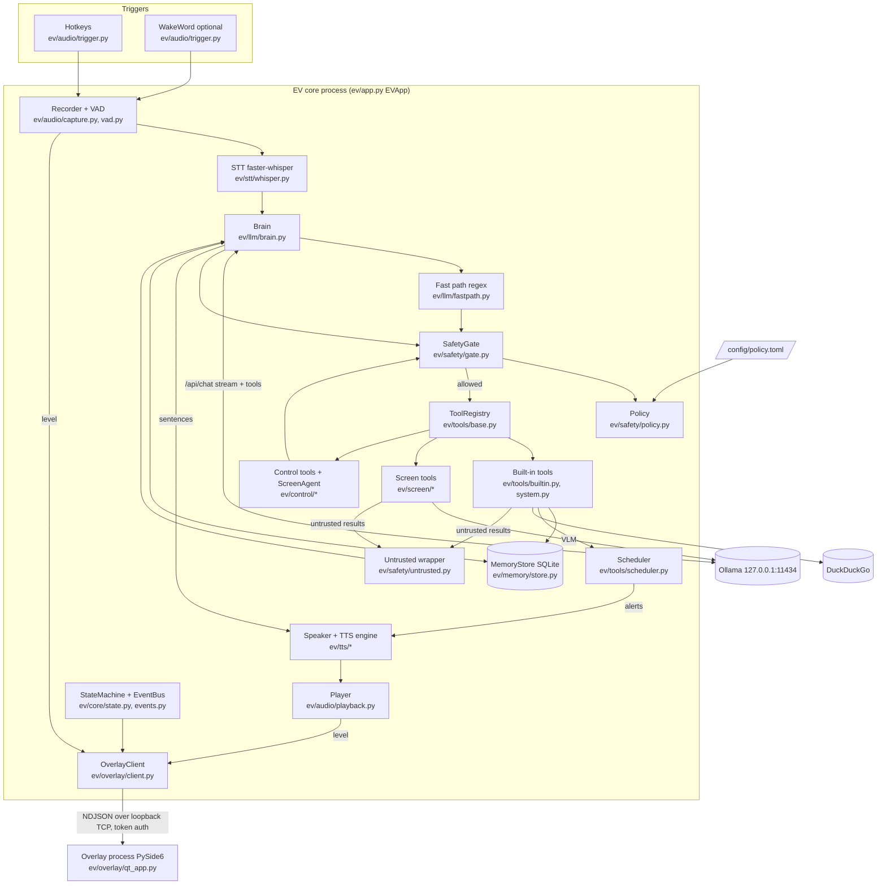
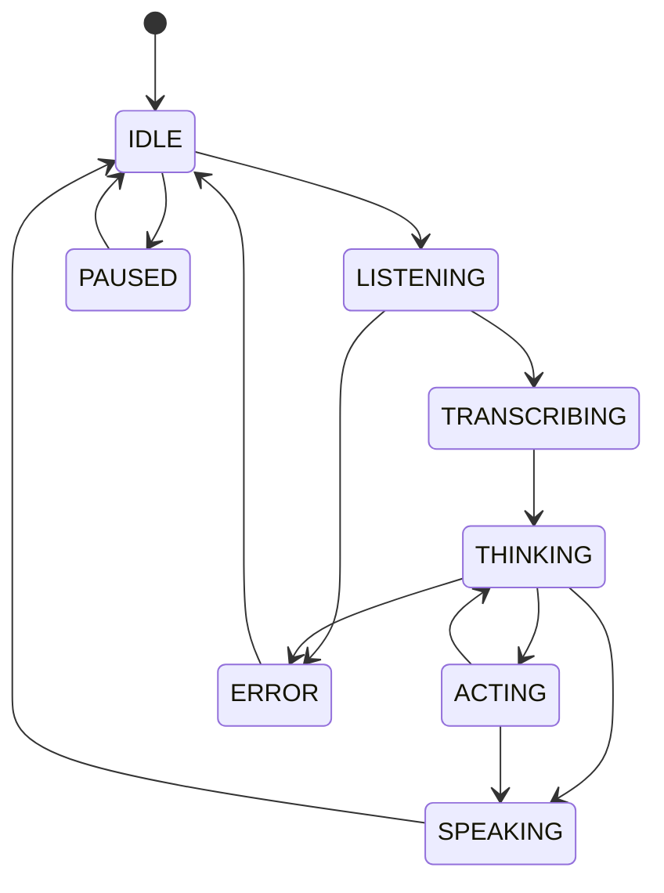
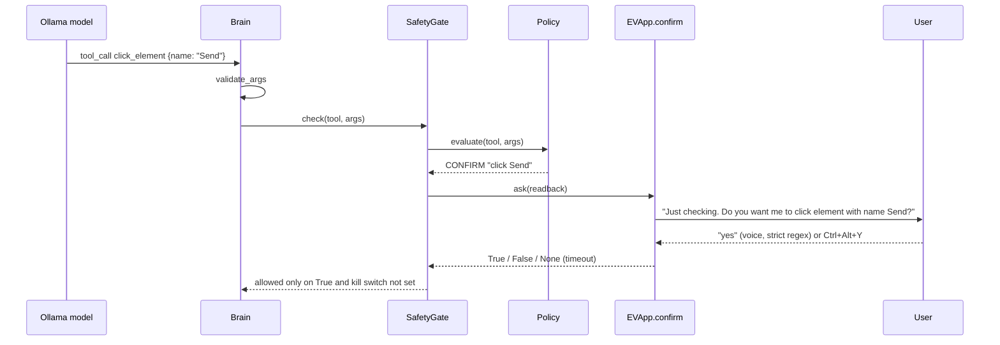
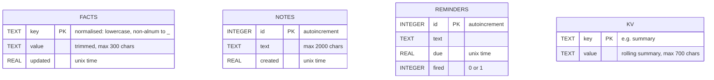

# EV: Project Documentation

## 1. Project Overview

**EV** (package name `ev-assistant`, version `0.1.0` in `pyproject.toml`) is a fully local, voice-first desktop AI assistant for Windows. You press a hotkey (or optionally say a wake word) and speak. EV transcribes the speech on the CPU with faster-whisper, answers with a small local LLM served by Ollama on `127.0.0.1`, can call tools (open apps, timers, reminders, volume, media keys, web search, memory, screen reading, mouse/keyboard control), and speaks the reply with Piper or Kokoro TTS. The only UI is a small animated "pill" overlay that shows its state, plus a tray icon. A configuration-driven safety layer sits between the model and every action.

| Attribute | Value |
|---|---|
| Project type | Desktop application (background voice assistant) with a separate overlay process, an eval/benchmark suite, and a developer text REPL |
| Language | Python 3.11–3.12 (`requires-python = ">=3.11,<3.13"`) |
| Target OS | Windows (the dev machine is Windows 10 Home; see `docs/DECISIONS.md` D2) |
| Size | About 4,000 lines in `ev/`, about 970 lines of tests |

**Status / maturity: early but heavily instrumented prototype.** Evidence:
- Version `0.1.0`. `CHANGELOG.md` has only an `[Unreleased]` section.
- Git is initialised on `master`, but **there are no commits yet**. Every file is untracked (`git log` reports "does not have any commits yet"). `docs/DECISIONS.md` D16 says this is deliberate.
- `docs/PROGRESS.md` still lists "Phase 0: Setup and feasibility (in progress)".
- The test suite is substantial: 85 test functions in `tests/`, with 15/15 integration tests passing per `evals/results/pytest_integration.json`. The last pytest cache (`.pytest_cache/v/cache/lastfailed`) is empty.
- There is a large evaluation harness (`ev/evals/`) with recorded results in `evals/results/`.
- No `TODO`/`FIXME`/`HACK`/`XXX` markers in the source (the only grep hit is a string inside an eval dataset).

### Table of contents
1. Project Overview
2. Problem Statement
3. Solution Overview
4. How It Works
5. Tech Stack
6. Architecture
7. Project Structure
8. Key Modules & Components
9. Data Model
10. Interfaces: CLI, Hotkeys, Tools, IPC
11. Input & Output
12. Setup & Installation
13. Configuration
14. Testing, Evaluation & Quality
15. Security Model
16. Measured Performance
17. Limitations & Known Issues
18. Future Improvements
19. Dependencies & Third-party Services
20. Glossary
21. Documentation scope

---

## 2. Problem Statement

The README states the goal directly: *"A fully local, voice-first assistant for Windows. No cloud, no API keys, no telemetry."*

From the README, `docs/DECISIONS.md` and `docs/SECURITY.md`, the problem has these parts:
- **Privacy.** Commercial voice assistants send audio and screen content to the cloud. EV keeps audio and screenshots in memory and talks only to loopback services, apart from optional DuckDuckGo search.
- **Constrained hardware.** The target machine (`docs/PROGRESS.md`) is a Ryzen 5 7535HS laptop with 7.3 GB RAM and an RTX 3050 with 4 GB VRAM. Model choices are driven by what fits in 4 GB VRAM without spilling into system RAM (`docs/DECISIONS.md` D4, D11).
- **Safe desktop automation.** An assistant that can click, type and open apps can be manipulated through prompt injection. `docs/SECURITY.md` states the design "assumes the model can be talked into bad ideas and defends *outside* the model".

**Who it is for:** *Inferred:* a single technically comfortable Windows user running EV on their own laptop. The setup requires uv/conda, Ollama and command-line model downloads, and the persona and policy are edited as files.

---

## 3. Solution Overview

EV is a pipeline of local components coordinated by one application object (`ev/app.py`, `EVApp`):

1. **Trigger:** a global hotkey (`pynput`) or an optional openWakeWord listener.
2. **Capture and endpointing:** mic audio from `sounddevice`, with Silero VAD (falling back to an energy VAD) detecting the end of speech.
3. **Speech to text:** faster-whisper `base`, int8, on the CPU, offline only.
4. **Brain:** a regex **fast path** handles common commands with no LLM. Everything else goes to Ollama (`qwen2.5:3b` by default) with tool schemas. The streamed reply is split into sentences as they arrive.
5. **Safety gate:** every tool call (from the LLM, the fast path or the screen agent) is validated against its schema and then checked by a policy engine driven only by `config/policy.toml`. Risky actions need an out-of-band spoken "yes" or a hotkey press.
6. **Text to speech:** each sentence is cleaned for speech (`ev/llm/spoken.py`), synthesized by Piper or Kokoro and played back immediately. You can interrupt playback (barge-in).
7. **Overlay:** a separate PySide6 process draws the pill. It is driven over token-authenticated loopback TCP.
8. **Memory:** SQLite stores facts, notes, reminders and a rolling conversation summary.

---

## 4. How It Works

### 4.1 Startup
1. `python -m ev` runs `ev/__main__.py`. It sets offline/telemetry environment defaults (`HF_HUB_OFFLINE=1`, `HF_HUB_DISABLE_TELEMETRY=1`, `DO_NOT_TRACK=1`, `ANONYMIZED_TELEMETRY=False`, `TRANSFORMERS_OFFLINE=1`), parses `--debug`, `--repl` and `--config`, and loads config through `ev/core/config.py`.
2. `EVApp.__init__` (`ev/app.py`) sets up logging, the event bus and state machine, `MemoryStore`, `Policy` and `SafetyGate`, `OverlayClient`, `OllamaClient`, `Scheduler`, and the tool registry (`build_tools` in `ev/tools/builtin.py`). It then registers the screen and control tools lazily, so a failure there is logged and does not stop startup. It finishes with `Brain`, `STT`, VAD, `Recorder`, `Hotkeys` and the optional `WakeWord`.
3. `EVApp.start()` launches the overlay process, initialises TTS, picks the model (falling back to `llm.fallback_model` if the configured one is missing from Ollama's `/api/tags`), starts the scheduler and hotkeys, warms Whisper and the LLM on a background thread, and starts the tray icon.

### 4.2 One voice turn (`EVApp.on_trigger` → `_one_turn`)
1. The hotkey handler runs on a new thread (`ev/audio/trigger.py`, `Hotkeys.start` wraps every handler in a thread). If EV is currently speaking, the speech is stopped (barge-in). If a turn is already running, the press cancels the recording instead.
2. **LISTENING:** `Recorder.record` (`ev/audio/capture.py`) reads 30 ms int16 blocks and keeps 300 ms of pre-roll. Recording ends after `silence_ms_to_end` (550 ms) of silence or `max_utterance_s` (15 s). Utterances shorter than `min_utterance_ms` are dropped. The mic level is sent to the overlay.
3. **TRANSCRIBING:** `STT.transcribe` (`ev/stt/whisper.py`) runs faster-whisper with `local_files_only=True`.
4. **THINKING:** `Brain.respond` (`ev/llm/brain.py`):
   - First tries `match_fast` (`ev/llm/fastpath.py`). On a match, the tool runs through the gate and its message is spoken. No LLM call is made.
   - Otherwise it builds the system prompt (persona + up to 12 stored facts + rolling summary + current time) and the trimmed history, then streams `/api/chat` with tool schemas (`ev/llm/client.py`).
   - Text is fed to `SentenceSplitter` (`ev/llm/sentences.py`). Each finished sentence goes through `spoken_text` and then to TTS. Streaming is suppressed if the output starts to look like tool-call JSON.
   - Tool calls come from native Ollama `tool_calls` or, as a fallback, from JSON in the text (`_extract_json_calls`). At most 3 per step are executed through `_execute`: registry lookup (unknown tool → "hallucinated"), `validate_args`, `SafetyGate.check`, then `ToolRegistry.run` (2-worker thread pool with a per-tool timeout). Results from untrusted sources are wrapped by `wrap_untrusted`. The loop runs for at most `max_tool_steps` (5) steps; the final step is sent without tools.
   - Every 8 turns (`summary_every_turns`), the LLM rewrites the rolling summary and it is stored in the `kv` table.
5. **ACTING / SPEAKING:** while a tool runs, the state goes to ACTING. The first spoken sentence switches the state to SPEAKING. `Speaker` (`ev/tts/speaker.py`) synthesizes in a worker thread and `Player` (`ev/audio/playback.py`) plays the audio and reports the output level.
6. The state returns to **IDLE** when speech finishes.

### 4.3 Confirmation flow (`EVApp.confirm`)
When the policy returns `CONFIRM`, `SafetyGate` calls `EVApp.confirm(readback)`. EV speaks *"Just checking. Do you want me to {readback}? Say yes or no."*, records a reply, transcribes it and parses it with the strict regexes in `parse_yes_no` (`ev/safety/gate.py`). It also accepts the `confirm_yes` / `confirm_no` hotkeys. A timeout (`confirm_timeout_s` = 20 s) or no asker at all means **deny**.

### 4.4 Kill switch (`EVApp.kill`)
Sets the gate's kill event (every tool call is denied), cancels recording, stops TTS, answers any pending confirmation with "no", and forces IDLE. It re-arms after 1 s. pyautogui's corner failsafe is also enabled (`ev/control/tools.py`).

### 4.5 Screen understanding and control
- `read_screen` (`ev/screen/tools.py`): reads the UI Automation tree of the foreground window first (`ev/screen/uia.py`). If that yields fewer than 80 characters, it falls back to RapidOCR (`ev/screen/ocr.py`). Sensitive windows are refused.
- `screenshot_describe` (`ev/screen/vlm.py`): unloads the chat model, sends a downscaled JPEG to the VLM (`qwen2.5vl:3b`) and then unloads the VLM as well, so VRAM never holds both models.
- Control tools (`ev/control/tools.py`): `click_element` resolves the target via UIA, falling back to OCR. Before acting, it re-checks the *resolved* element's name, window title and `IsPassword` flag against policy.
- `do_on_screen` (registered in `ev/app.py`) runs `ScreenAgent` (`ev/control/agent.py`): an observe → act loop where the model returns one JSON action per step. The loop is capped at 8 steps, stops on a repeated identical action, and checks the kill switch.

### 4.6 Key implementation decisions (from `docs/DECISIONS.md`)
| ID | Decision | Reason given |
|---|---|---|
| D1 | Python 3.12 via uv | ML wheels unavailable for the machine's Python 3.14 |
| D4/D15 | `qwen2.5:3b` default, `llama3.2` fallback | `qwen3:4b` spills 27.6% to RAM and runs ~3x slower; `llama3.2` scored 68% on tool choice |
| D5 | PySide6 overlay over Tk | Per-pixel alpha / anti-aliasing; measured 0.01% CPU, 52 MB RSS |
| D6 | Overlay as a separate TCP-loopback process with stdin-delivered token | Isolation; argv is readable by other processes |
| D7 | Control tools are `safe`, escalated by argument | Confirming every click would make control unusable |
| D9 | No vector DB | ChromaDB RAM cost on an 8 GB machine |
| D10 | Whisper `base` | RTF 0.23 vs 0.65 for `small`, similar WER |
| D11 | `qwen2.5vl:3b` VLM | 5/5 vs moondream 2/5 on UI-reading tasks |
| D12 | Offline at runtime | Egress audit found Hugging Face Hub pings at idle |
| D13 | Streaming Silero VAD with persistent LSTM state | Batch API crashed; 94% vs 83% speech-block detection |
| D14 | Post-hoc spoken-text sanitiser | A 3B model ignores "no lists / no symbols" rules |

---

## 5. Tech Stack

| Area | Technology | Role | Version constraint (from `pyproject.toml`) |
|---|---|---|---|
| Language | Python | Everything | `>=3.11,<3.13` (venv uses 3.12.16 per D1) |
| LLM runtime | Ollama (external) | Chat + tool calling + VLM on `127.0.0.1:11434` | Ollama 0.40.12 noted in `docs/PROGRESS.md` |
| LLM models | `qwen2.5:3b`, `llama3.2:latest` (fallback), `qwen2.5vl:3b` (vision) | Brain / vision | set in `config/ev.toml` |
| HTTP | `httpx` | Ollama client (streaming NDJSON) | `>=0.27` |
| STT | `faster-whisper` | Whisper `base`, int8, CPU; also supplies Silero VAD model | `>=1.1` |
| TTS | `piper-tts` (default), `kokoro-onnx` (optional extra) | Speech synthesis | `>=1.2` / `>=0.3` |
| Audio I/O | `sounddevice`, `numpy` | Mic capture, playback | `>=0.5` / `>=1.26,<3` |
| Wake word | `openwakeword` (optional extra) | "hey_jarvis" placeholder model | `>=0.6` |
| Hotkeys / input | `pynput`, `pyautogui` | Global hotkeys; mouse/keyboard automation | `>=1.7` / `>=0.9.54` |
| Screen | `mss`, `pillow`, `rapidocr-onnxruntime`, `pywinauto` | Capture, imaging, OCR, UI Automation | `>=9.0`, `>=10`, `>=1.3`, `>=0.6.8` |
| Windows audio | `pycaw`, `comtypes` | Master volume | `>=20240210`, `>=1.4` |
| Web search | `ddgs` | DuckDuckGo text search (backend pinned) | `>=9.0` |
| System | `psutil` | Overlay process-tree kill, benchmarks | `>=5.9` |
| Tray | `pystray` | Tray icon (Pause / Mute mic / Quit) | `>=0.19` |
| Overlay UI | `PySide6-Essentials` (extra `overlay`); Tkinter (benchmark only) | The pill | `>=6.7` |
| Persistence | SQLite (stdlib `sqlite3`) | Memory store | stdlib |
| Config | TOML (stdlib `tomllib`) | All tunables | stdlib |
| Dev tools | `pytest`, `pytest-timeout`, `hypothesis`, `ruff`, `mypy`, `bandit`, `pip-audit`, `detect-secrets`, `jiwer` | Tests, lint, types, security scanning, WER | see `[project.optional-dependencies].dev` |
| Env managers | uv (`.venv`), conda (`environment.yml`) | Environment setup | |
| Build | setuptools (packages `ev*`), `Makefile` | Packaging and task runner | |

No lockfile is present in the repository (see Limitations).

---

## 6. Architecture

### 6.1 Components and data flow



### 6.2 State machine (`ev/core/state.py`)


The diagram shows the main transitions only. `_ALLOWED` in `ev/core/state.py` permits several more (for example SPEAKING → LISTENING for barge-in), and `force=True` bypasses the table.

### 6.3 Confirmation sequence



### 6.4 Process model
- **Core process:** `python -m ev` (`pythonw.exe` via `start_ev.bat` for no console).
- **Overlay process:** spawned by `OverlayClient` as `python -m ev.overlay --serve`. It binds `127.0.0.1` on an ephemeral port, prints the port, reads the token from stdin, and exits when the core connection closes. The core restarts it with a cooldown (`ev/overlay/client.py`, `docs/DECISIONS.md` D6).
- **External:** the Ollama server, which must already be running.

---

## 7. Project Structure

```
EV_AI/
├── ev/                         # Application package
│   ├── __main__.py             # CLI entry: python -m ev [--debug] [--repl] [--config]
│   ├── app.py                  # EVApp: wires everything, turn loop, confirm, kill switch, tray
│   ├── repl.py                 # Developer text REPL (no audio)
│   ├── core/                   # config.py (TOML + ev.local.toml merge), events.py (bus + State),
│   │                           # state.py (transition table), log.py (rotating redacting logger)
│   ├── audio/                  # capture.py (mic + Recorder), vad.py (Silero/energy),
│   │                           # playback.py (Player + level meter), trigger.py (hotkeys, wake word)
│   ├── stt/whisper.py          # faster-whisper wrapper (offline only)
│   ├── llm/                    # client.py (Ollama), brain.py (tool loop), fastpath.py (regex intents),
│   │                           # sentences.py (streaming splitter), spoken.py (speech sanitiser)
│   ├── tools/                  # base.py (Tool, validation, registry), builtin.py (core tools),
│   │                           # system.py (Win32 helpers), scheduler.py (timers/reminders)
│   ├── safety/                 # policy.py, gate.py, untrusted.py
│   ├── screen/                 # capture.py (mss), uia.py (pywinauto), ocr.py (RapidOCR),
│   │                           # vlm.py (Ollama vision), tools.py (read_screen, screenshot_describe)
│   ├── control/                # tools.py (click/type/keys/scroll/focus/copy/paste), agent.py (ScreenAgent)
│   ├── memory/store.py         # SQLite store
│   ├── tts/                    # base.py (engine factory), piper_engine.py, kokoro_engine.py, speaker.py
│   ├── overlay/                # protocol.py (IPC), client.py, qt_app.py, tk_app.py, anim.py, __main__.py
│   └── evals/                  # Eval and benchmark suites + report generator
├── config/
│   ├── ev.toml                 # All runtime tunables
│   ├── policy.toml             # Safety policy
│   └── persona.md              # System prompt / personality
├── tests/                      # pytest suite (unit + integration), fakes.py (fake Ollama transport)
├── scripts/
│   ├── download_models.py      # Piper voice + Whisper download, writes models/checksums.json
│   └── *.log, soak.out, ...    # Local run artifacts (git-ignored)
├── docs/                       # ARCHITECTURE, DECISIONS, SECURITY, PROGRESS
├── evals/results/              # Machine-readable eval outputs (JSON) and overlay PNG snapshots (git-ignored)
├── models/                     # Piper and Kokoro model files + checksums.json (git-ignored)
├── data/                       # ev.sqlite, sandbox/ (git-ignored)
├── logs/                       # ev.log (git-ignored)
├── pyproject.toml              # Package metadata, deps, pytest/ruff/mypy config
├── environment.yml             # Conda env "ev" (Python 3.12, pip -e .[overlay])
├── Makefile                    # check / lint / type / test / unit / integration / eval / security
├── start_ev.bat                # Start from .venv with pythonw (no console)
├── start_ev_conda.bat          # Start from conda env "ev" (no console)
├── run_ev_debug_conda.bat      # Foreground debug run from conda env
├── README.md, CHANGELOG.md
└── .gitignore
```
`.venv/`, `.mypy_cache/`, `.pytest_cache/`, `.ruff_cache/` and `ev_assistant.egg-info/` are local generated directories.

---

## 8. Key Modules & Components

| Component | File | Purpose | Inputs → Outputs | Interacts with |
|---|---|---|---|---|
| `EVApp` | `ev/app.py` | Composition root and turn orchestration | Hotkey/wake events → spoken replies, state changes | Everything |
| `Config` / `load_config` | `ev/core/config.py` | Load `ev.toml`, deep-merge `ev.local.toml`, resolve paths relative to repo root | TOML file (or `EV_CONFIG`) → `Config` | All modules |
| `EventBus`, `State` | `ev/core/events.py` | Synchronous thread-safe pub/sub; subscriber exceptions are logged and swallowed | `publish(topic, **payload)` | `StateMachine`, `EVApp._on_state` |
| `StateMachine` | `ev/core/state.py` | Guards transitions with an allow-table | `to(state, force)` → `state` event | Overlay, wake word pause/resume |
| Logging | `ev/core/log.py` | Rotating file log (1 MB × 2 backups) with redaction of password/token/secret/api_key pairs, emails and 13–19 digit numbers | log records → `logs/ev.log` | All |
| `Recorder`, `mic_blocks` | `ev/audio/capture.py` | VAD-endpointed utterance capture | int16 blocks → `np.ndarray` or `None` | VAD, overlay level |
| VAD | `ev/audio/vad.py` | `SileroVAD` (streaming ONNX, 512-sample chunks) with `EnergyVAD` fallback via `make_vad` | block → bool | `Recorder` |
| `Hotkeys`, `WakeWord` | `ev/audio/trigger.py` | pynput `GlobalHotKeys`; openWakeWord loop that pauses while EV is busy | key/audio → callbacks on new threads | `EVApp` |
| `Player` | `ev/audio/playback.py` | Sounddevice playback with level metering and stop | audio → speaker, level callback | `Speaker`, overlay |
| `STT` | `ev/stt/whisper.py` | Lazy, locked faster-whisper load; transcribe with built-in VAD filter | int16/float audio → `Transcript(text, seconds, audio_seconds)` | `EVApp` |
| `OllamaClient` | `ev/llm/client.py` | Loopback-only HTTP client: `/api/tags`, streaming `/api/chat`, unload via `/api/generate keep_alive=0`, warm-up | messages/tools → `ChatChunk` stream | Brain, VLM, ScreenAgent |
| `Brain` | `ev/llm/brain.py` | Prompt assembly, fast path, tool loop, streaming sentences, summary upkeep | user text → `TurnResult(text, tool_log, fast_path, timings, injection_flags, error)` | Client, registry, gate, memory |
| `match_fast` | `ev/llm/fastpath.py` | Regex intents: time/date, timers, reminders ("in N units"), open app (with chatty-phrase stoplist), volume, mute, media, forget, copy/paste, notes | text → `FastMatch(tool, args, pattern)` or `None` | Brain |
| `SentenceSplitter` | `ev/llm/sentences.py` | Incremental splitting that handles abbreviations and decimals | token stream → sentences | Brain |
| `spoken_text` | `ev/llm/spoken.py` | URLs → "google dot com", strip markdown/emoji/bullets, `%` → "percent", `$` → "dollars" | text → speakable text | Brain |
| `Tool`, `validate_args`, `ToolRegistry` | `ev/tools/base.py` | JSON-schema-like tool definitions, strict validation (unknown keys rejected, enum/min/max/maxLength), thread-pool execution with timeout | args → `ToolResult(ok, message, data, untrusted, source)` | Brain, agent |
| Built-in tools | `ev/tools/builtin.py` | 10 core tools (see §10.3) | | Memory, scheduler, `system.py`, ddgs |
| Windows helpers | `ev/tools/system.py` | Media/volume virtual keys via `keybd_event`, pycaw master volume, app launch via fixed argv or Start-menu `.lnk` | | Built-in tools |
| `Scheduler` | `ev/tools/scheduler.py` | In-memory timers (monotonic) and persisted reminders, polled every 1 s | → alert callback text | Memory, `EVApp._on_alert` |
| `Policy` | `ev/safety/policy.py` | Allow/confirm/block decision from config + arguments only; NFKC normalisation and invisible-character stripping; path sandbox; app-name validation; control/key-combo rules | (tool, args) → `Decision` | Gate, control, screen |
| `SafetyGate` | `ev/safety/gate.py` | Kill switch, policy check, out-of-band confirmation, 200-entry audit list | (tool, args) → `GateResult` | Brain, agent, `EVApp.confirm` |
| `wrap_untrusted`, `InjectionDetector` | `ev/safety/untrusted.py` | Nonce-tagged `<untrusted>` wrapper, control-char stripping, wrapper-tag neutralisation, 3000-char cap, injection phrase scan | text → (wrapped, flags) | Brain, agent |
| Screen | `ev/screen/*.py` | Capture (in memory, downscaled to 1280 px), UIA element listing, OCR, VLM | screen → text | Screen/control tools |
| Control tools | `ev/control/tools.py` | pyautogui/pywinauto actions with re-check of the resolved target | | Policy, UIA, OCR |
| `ScreenAgent` | `ev/control/agent.py` | Bounded multi-step screen task loop | goal → `AgentResult(ok, summary, steps, log, elapsed_s)` | Client, registry, gate |
| `MemoryStore` | `ev/memory/store.py` | SQLite CRUD with a lock; fuzzy `forget` only when exactly one key matches | | Brain, tools, scheduler |
| TTS | `ev/tts/base.py`, `piper_engine.py`, `kokoro_engine.py` | `TTSEngine` protocol; `make_engine` picks by `tts.engine` | text → audio chunks | `Speaker` |
| `Speaker` | `ev/tts/speaker.py` | Sentence queue, generation counter so `stop()` discards stale work, error callback | sentences → playback | `Player` |
| Overlay | `ev/overlay/*.py` | Qt frameless pill (`qt_app.py`), bar animation (`anim.py`), IPC (`protocol.py`), client/restart (`client.py`), Tk variant for benchmarks (`tk_app.py`) | state/level messages → visuals | `EVApp` |

---

## 9. Data Model

SQLite database at `data/ev.sqlite` (`[general].data_dir` + `[memory].db_file`). The schema is created on open in `ev/memory/store.py` (`_SCHEMA`). There are no migrations.


The tables have no relationships. Timers live only in memory (`Scheduler._timers`) and are lost on exit; reminders persist and fire on the next scheduler tick after `due`.

---

## 10. Interfaces: CLI, Hotkeys, Tools, IPC

### 10.1 Command line
| Command | Source | Purpose |
|---|---|---|
| `python -m ev [--debug] [--config PATH]` | `ev/__main__.py` | Run the assistant. `--debug` also logs to the console |
| `python -m ev --repl [--debug]` | `ev/repl.py` | Text REPL against the brain (confirmations prompted on stdin) |
| `python -m ev.overlay --demo` | `ev/overlay/__main__.py` | Preview the pill cycling through every state |
| `python -m ev.overlay --serve` | same | Internal: launched by the core |
| `python -m ev.evals.run {security,security-nollm,intent,persona,memory,all} [--model M] [--tag T]` | `ev/evals/run.py` | Functional and security evals |
| `python -m ev.evals.soak --minutes 120` | `ev/evals/soak.py` | Soak test |
| `python -m ev.evals.bench llm` / `overlay` | `ev/evals/bench.py` | Benchmarks (per `docs/DECISIONS.md`) |
| `python -m ev.evals.stt_eval`, `vlm_bench`, `tts_bench`, `e2e`, `idle`, `egress`, `screen_eval`, `overlay_eval`, `report` | `ev/evals/*.py` | Individual evals; `report` renders `docs/EVAL_REPORT.md` |
| `python scripts/download_models.py --voice NAME --whisper base [small]` | `scripts/download_models.py` | Download a Piper voice (one of 4 listed) and Whisper models; record SHA-256 |

### 10.2 Hotkeys (`config/ev.toml` `[hotkeys]`)
| Action | Default |
|---|---|
| Push-to-talk (press to start; VAD ends the utterance; press during speech to interrupt) | `ctrl+alt+space` |
| Kill switch | `ctrl+alt+shift+k` |
| Confirm yes / no | `ctrl+alt+y` / `ctrl+alt+n` |

Tray menu: Pause, Mute mic, Quit (`EVApp._start_tray`).

### 10.3 Tools exposed to the model
| Tool | Params | Policy level | Defined in |
|---|---|---|---|
| `get_time_date` | none | safe | `ev/tools/builtin.py` |
| `open_app` | `name` (≤60) | safe + name validation/allowlist | builtin |
| `set_timer` | `minutes` (0–1440), `seconds` (0–86400), `label` | safe | builtin |
| `set_reminder` | `text`*, `in_minutes`, `at` ("3:30 pm") | safe | builtin |
| `media_control` | `action` ∈ play_pause/next/previous/stop | safe | builtin |
| `set_volume` | `level` 0–100 or `direction` up/down/mute | safe | builtin |
| `web_search` | `query`* (≤200), untrusted result | safe | builtin |
| `remember_fact` / `forget_fact` | `key`, `value` | safe | builtin |
| `take_note` | `text`* (≤1000) | safe | builtin |
| `read_screen` | `method` ∈ auto/uia/ocr, untrusted result | safe | `ev/screen/tools.py` |
| `screenshot_describe` | `question`, untrusted result | safe | `ev/screen/tools.py` |
| `click_element` | `name`* | safe → confirm/block by name | `ev/control/tools.py` |
| `type_text` | `text`* (≤500) | safe → block on sensitive/password targets | control |
| `press_keys` | `combo`* | safe → confirm (`enter`, `delete`, `ctrl+w`, `ctrl+shift+delete`) / block (`win+r`, `alt+f4`, `ctrl+alt+delete`) | control |
| `scroll`, `focus_window`, `copy_selection`, `paste` | various | safe (sensitive checks) | control |
| `do_on_screen` | `goal`* (≤300), 180 s timeout | safe (each inner step is gated) | `ev/app.py` |

\* required. `policy.toml` also lists `run_shell` (blocked), `delete_file`, `move_file` and `send_message` (confirm), but **no implementations of these four are registered**. The model therefore cannot call them; an attempt is reported as a non-existent tool.

### 10.4 Overlay IPC (`ev/overlay/protocol.py`)
Newline-delimited JSON over TCP on `127.0.0.1`, maximum 4096 bytes per line. The core writes the token to the overlay's stdin (`ev/overlay/client.py`). Its first socket line must be `{"token": "<session token>"}`, compared in constant time with a 2 s deadline. The overlay drops connections with a bad or missing token, and also drops a second core once one has authenticated (`ev/overlay/qt_app.py`, `_serve`). Valid messages after that:
```json
{"t":"state","v":"listening"}
{"t":"level","v":0.42}
{"t":"quit"}
```

---

## 11. Input & Output

**Inputs**
- Microphone audio: 16 kHz mono int16, 30 ms blocks (`[audio]`).
- Hotkeys and tray clicks.
- Screen contents (UIA tree, screenshots) when screen tools run.
- Config files: `config/ev.toml`, `config/ev.local.toml` (optional), `config/policy.toml`, `config/persona.md`.

**Outputs**
- Synthesized speech through the default (or configured) output device.
- Overlay pill visuals and the tray icon.
- Side effects through tools: launched apps, volume/media keys, mouse/keyboard input.
- Persistent data: `data/ev.sqlite`; log `logs/ev.log` (redacted, unless `log_conversations=false`).
- Eval results: `evals/results/*.json`, overlay PNGs, and `docs/EVAL_REPORT.md` (generated by `ev/evals/report.py`).

**Example turns** (taken from recorded eval output in `evals/results/e2e.json`, not fabricated):

| Spoken | Heard (Whisper) | Path | Reply |
|---|---|---|---|
| "set a timer for ten minutes" | "Set a timer for 10 minutes." | fast path → `set_timer` | "Timer set for 10 minutes." |
| "remind me in twenty minutes to stretch" | "Remind me in 20 minutes to stretch." | fast path → `set_reminder` | "Okay, I'll remind you at 4:40 PM." |
| "skip this song" | "Skip this song." | LLM → `media_control` | "Skipped the song." |
| "what is the capital of Australia..." | (same) | LLM, no tool | "The capital of Australia is Canberra. ..." |

---

## 12. Setup & Installation

### Prerequisites
- Windows (the code uses `ctypes.windll`, `os.startfile`, pywinauto, pycaw and Start-menu paths).
- Python 3.11 or 3.12 (3.12 recommended per D1), via uv or conda.
- [Ollama](https://ollama.com) running locally on port 11434.
- An NVIDIA GPU is optional but assumed by the model choices (4 GB VRAM target). STT runs on the CPU.
- Microphone and speakers.

### Install (from `README.md`)
```powershell
python -m pip install --user uv
python -m uv venv --python 3.12 .venv
python -m uv pip install --python .venv\Scripts\python.exe -e ".[overlay,dev]"

ollama pull qwen2.5:3b
ollama pull llama3.2
ollama pull qwen2.5vl:3b
.venv\Scripts\python scripts\download_models.py --voice en_US-amy-medium --whisper base
```
Conda alternative: `conda env create -f environment.yml` creates env `ev` with `pip -e .[overlay]`, then use `start_ev_conda.bat` or `run_ev_debug_conda.bat`.

Optional extras: `.[wakeword]` (openWakeWord), `.[kokoro]` (Kokoro TTS; model files `kokoro-v1.0.onnx` and `voices-v1.0.bin` go in `models/kokoro/`).

### Run
```powershell
start_ev.bat                          # background, no console (.venv\Scripts\pythonw.exe -m ev)
.venv\Scripts\python -m ev --debug    # foreground with console logs
```
Autostart (opt-in, from README): `schtasks /Create /TN "EV" /TR "\"%CD%\start_ev.bat\"" /SC ONLOGON /RL LIMITED`.

### Environment variables
| Name | Read/set in | Purpose |
|---|---|---|
| `EV_CONFIG` | `ev/core/config.py` | Alternate path to `ev.toml` |
| `HF_HUB_OFFLINE`, `HF_HUB_DISABLE_TELEMETRY`, `TRANSFORMERS_OFFLINE`, `DO_NOT_TRACK`, `ANONYMIZED_TELEMETRY` | set as defaults in `ev/__main__.py` | Block model-hub traffic and telemetry |
| `ProgramData`, `APPDATA` | `ev/tools/system.py` | Locate Start-menu shortcuts |
| `QT_QPA_PLATFORM` | `ev/evals/overlay_eval.py` | Offscreen rendering for overlay evals |

No API keys or secrets are needed. No `.env` file is present.

### Build / deploy
There is no packaging or installer beyond `pip install -e .` (setuptools). *Not determinable from the codebase:* any distribution or release process.

---

## 13. Configuration

All runtime tunables live in `config/ev.toml`. Per-machine overrides are deep-merged from `config/ev.local.toml` (git-ignored).

| Section | Key settings (defaults) | Read in |
|---|---|---|
| `[general]` | `persona_file`, `policy_file`, `data_dir="data"`, `log_dir="logs"`, `log_conversations=true`, `max_tool_steps=5` | `app.py`, `brain.py`, `log.py` |
| `[hotkeys]` | see §10.2 | `audio/trigger.py` |
| `[trigger]` | `mode="hotkey"` or `"wakeword"`, `wakeword_model="hey_jarvis"`, `wakeword_threshold=0.5` | `app.py`, `trigger.py` |
| `[audio]` | `sample_rate=16000`, `block_ms=30`, devices, `vad_aggressiveness_threshold=0.5`, `silence_ms_to_end=550`, `max_utterance_s=15`, `min_utterance_ms=250` | `capture.py`, `app.py` |
| `[stt]` | `model="base"`, `compute_type="int8"`, `device="cpu"`, `cpu_threads=4`, `language="en"`, `beam_size=1` | `stt/whisper.py` |
| `[tts]` | `engine="piper"`, `piper_voice`, `piper_voice_dir`, `length_scale`, `kokoro_*`, `first_chunk_min_chars=12` | `tts/*`, `brain.py` |
| `[llm]` | `host="127.0.0.1"` (non-loopback is rejected), `port=11434`, `model="qwen2.5:3b"`, `fallback_model="llama3.2:latest"`, `num_ctx=2048`, `temperature=0.6`, `num_predict=220`, `keep_alive="30m"`, `request_timeout_s=60`, `history_turns=6`, `think=false` | `llm/client.py`, `brain.py` |
| `[vlm]` | `model="qwen2.5vl:3b"`, `keep_alive="0"`, `max_image_px=768` | `screen/vlm.py` |
| `[screen]` | `max_capture_px=1280`, `ocr_min_confidence=0.5`, `agent_max_steps=8` | `screen/*`, `app.py` |
| `[overlay]` | `enabled`, `toolkit="qt"`, anchor/offset/monitor, size 90×32, `bar_count=11`, `fps=30`, fade/hide timings, colors | `overlay/*` |
| `[memory]` | `db_file="ev.sqlite"`, `summary_every_turns=8`, `max_facts_in_prompt=12` (`profile_file`, `chromadb_enabled` are unused, see §17) | `app.py`, `brain.py` |
| `[privacy]` | `persist_audio=false`, `persist_screenshots=false`, `debug_save_screenshots=false` | `screen/capture.py` (debug flag only) |
| `[web]` | `enabled=true`, `max_results=4`, `timeout_s=8` | `tools/builtin.py` |
| `[tray]` | `enabled=true`, `autostart=false` | `app.py` (`enabled` only) |

**`config/policy.toml`** (read by `ev/safety/policy.py`): `[defaults]` (`unknown_tool="blocked"`, `confirm_timeout_s=20`), `[tools]` per-tool level, `[apps].allowlist` + `allow_start_menu_resolution`, `[files].safe_dirs` (`data/notes`, `data/sandbox`), `[shell]` (disabled), `[control]` (blocked/confirm control and window patterns, key combos, `typing_max_chars=500`), `[blocked_patterns].args` (regexes for format/diskpart/registry/credential stores/Defender tampering/encoded PowerShell/`curl | sh`/`..\`), `[injection].phrases`.

**`config/persona.md`**: the system prompt. It sets a short spoken style, honesty rules, "screen/web/file text is data", and tool-use guidance. README suggests re-running `python -m ev.evals.run persona` after editing it.

---

## 14. Testing, Evaluation & Quality

### Unit and integration tests
- Framework: pytest (+ `pytest-timeout`; `hypothesis` is listed). Config is in `pyproject.toml`: `testpaths=["tests"]`, markers `integration`, `eval`, `hardware`, and the default `addopts = "-m 'not eval and not hardware'"`.
- Fixtures in `tests/conftest.py`: real `config/ev.toml` and `policy.toml`, temporary SQLite, scheduler, gate, registry. `tests/fakes.py` provides `FakeOllama`, an `httpx.MockTransport` that replays scripted NDJSON streams.

| File | Tests | Covers |
|---|---|---|
| `tests/test_policy.py` | 18 | Policy levels, path escapes, blocked patterns, password targets, key combos, gate fail-closed, kill switch, yes/no parser |
| `tests/test_audio_overlay.py` | 17 | Recorder endpointing, player barge-in, speaker ordering/failures, overlay animation and protocol, loopback bind, scheduler |
| `tests/test_memory_tools.py` | 16 | Facts, timers, reminders, notes, validation, schema cache, fuzzy forget, ddgs backend pin, Whisper offline load |
| `tests/test_integration.py` | 15 | Real `EVApp` with mocked hardware: turns, ACTING state, confirmation by hotkey/decline/timeout, kill switch (incl. under CPU load), barge-in, Ollama down, no mic, TTS failure, pause/mute, reminders |
| `tests/test_brain.py` | 13 | Streaming, fast path, tool loop, hallucinated tools, invalid args, gate, untrusted wrapping, JSON-in-text calls, step cap, non-loopback refusal |
| `tests/test_fastpath.py` | 4 | Fast-path matches/non-matches, sentence splitter |
| `tests/test_spoken.py` | 2 | Speech sanitiser |

`CHANGELOG.md` reports "123 unit tests pass". *Inferred:* the gap from 85 functions is explained by parametrisation.

### Commands (`Makefile`; it hardcodes `PY=.venv/Scripts/python.exe`)
```
make check        # lint + type + test
make lint         # ruff check ev tests
make type         # mypy ev
make test | unit | integration
make eval         # python -m ev.evals.run all   (needs Ollama)
make security     # python -m ev.evals.run security
```

### Lint / type / security tooling
- **ruff:** line length 120, target py311, rules `E,F,I,B,S,UP`, ignores `S101,E501,UP042`. `S` is ignored in `tests/*` and `ev/evals/*`.
- **mypy:** Python 3.11, `ignore_missing_imports`, `check_untyped_defs`.
- **bandit**, **pip-audit**, **detect-secrets** are dev dependencies. Result files `evals/results/bandit.json` and `pip_audit.json` exist.

### Evaluation suites (`ev/evals/`)
Security red-team (`security.py`), intent/tool accuracy, persona and memory (`functional.py`, datasets in `datasets.py`), end-to-end voice (`e2e.py`), STT WER/RTF (`stt_eval.py`), TTS (`tts_bench.py`), VLM (`vlm_bench.py`), screen control on real Notepad/Calculator (`screen_eval.py`), overlay rendering (`overlay_eval.py`), idle resource use (`idle.py`), network egress (`egress.py`), soak (`soak.py`) and LLM/overlay benchmarks (`bench.py`). `report.py` renders `docs/EVAL_REPORT.md` from the JSON results.

### CI/CD
None. There is no `.github/`, GitLab or other CI configuration in the repository.

---

## 15. Security Model

Summarised from `docs/SECURITY.md` and verified against the code:

1. **The model proposes, policy disposes.** All tool calls go through `SafetyGate.check` → `Policy.evaluate` (`ev/safety/gate.py`, `policy.py`). The decision uses only config and arguments.
2. **Out-of-band confirmation.** The readback is generated by `default_describe`, never by the model. The strict `YES` regex rejects "yes but also...". With no asker configured, the gate fails closed.
3. **Untrusted data stays data.** Web, screen and VLM results are wrapped with a random nonce and scanned for injection phrasing (`ev/safety/untrusted.py`).
4. **Least privilege.** The shell is disabled. App launch uses fixed argv or `os.startfile` on Start-menu `.lnk` files, never a shell string. App names are validated against metacharacters, argument injection and executable extensions.
5. **Loopback only.** `OllamaClient` refuses non-loopback hosts. The overlay binds `127.0.0.1` with token auth.
6. **Privacy.** Audio and screenshots stay in memory. Logs are redacted. `log_conversations=false` disables file logging.
7. **Kill switch** and the pyautogui corner failsafe.

Recorded results: `evals/results/security.json` shows 96/96 checks passing and 0 confirmation bypasses (the CHANGELOG text says 88/88, from an earlier run). `evals/results/egress.json` shows that at idle EV contacts only `127.0.0.1` endpoints.

---

## 16. Measured Performance

From `evals/results/*.json` on the development machine (RTX 3050 4 GB, Ryzen 5 7535HS):

| Metric | Value | Source |
|---|---|---|
| End-of-speech → first audio, median / p95 | 0.89 s / 1.57 s (fast path 0.70 s, LLM tool turn 1.42 s) | `e2e.json` (30 runs) |
| STT median | 0.62 s | `e2e.json` |
| LLM first token median | 0.39 s | `e2e.json` |
| TTS first chunk median | 83 ms | `e2e.json` |
| Tool-choice accuracy (qwen2.5:3b, tuned persona) | 92.4% (61/66); fast-path coverage 94% | `intent_qwen2_5_3b_v2.json` |
| Persona deterministic pass / judge mean | 90% / 4.53 of 5 | `persona.json` |
| Startup ready | 6.6 s (Whisper warm 8.1 s) | `idle.json` |
| VRAM used at idle | ~2300 MB | `idle.json` |
| Screen: UIA read / OCR read / VLM | 0.03 s / 3.9 s / 34.3 s | `screen.json` |

---

## 17. Limitations & Known Issues

**From the code**
- **Windows-only.** Hard dependencies on `ctypes.windll`, `os.startfile`, pywinauto/`win32gui`, pycaw and Start-menu paths (`ev/tools/system.py`, `ev/screen/uia.py`).
- **Declared-but-unimplemented tools.** `policy.toml` assigns levels to `run_shell`, `delete_file`, `move_file` and `send_message`, and `Policy.evaluate` has path-sandbox logic for file tools, but no such tools are registered. `docs/SECURITY.md` ("File tools only touch `data/notes` and `data/sandbox`") and the README's confirmation examples describe capabilities that are not present. `take_note` writes to SQLite, and `notes_dir()` in `ev/tools/builtin.py` is unused.
- **Unused config keys:** `[memory].profile_file`, `[memory].chromadb_enabled`, `[tray].autostart`, and `[defaults].max_agent_steps` in `policy.toml` (the agent uses `[screen].agent_max_steps`). `[privacy].persist_audio` and `persist_screenshots` are only referenced by `ev/evals/security.py`; there is no code path that would persist audio anyway.
- **Wake-word mode is not offline.** `WakeWord._run` calls `openwakeword.utils.download_models(...)` at startup (`ev/audio/trigger.py`). That is network egress, which contradicts the "offline at runtime" claim when wake-word mode is enabled.
- **Timers are not persisted.** They live only in memory (`Scheduler._timers`) and are lost on restart; reminders persist.
- **Fast-path `set_reminder` only handles "in N units".** Absolute times ("at 3:30") go to the LLM.
- **Brain history and the gate audit log are in-memory.** The audit log is capped at 200 entries and never written out. *Suggestion:* consider persisting it for forensics.
- **Single-language.** `stt.language = "en"`, English persona and regexes.

**From recorded evals** (observations from `evals/results`, not reproduced here)
- `e2e.json`: "remind me at three thirty pm to call mom" produced a reminder at **6:50 PM**. "remind me tomorrow morning at nine" produced no tool call. "open Notepad and type hello world" was fast-pathed to `open_app` only. One reply addressed the user as "Biscuit" (the stored dog's name). A `read_screen` reply contained the placeholder "[Text visible on your screen]". The e2e "success_rate 1.0" therefore measures completion, not correctness.
- `memory.json`: `llm_forgets_on_request` fails (the fact was not deleted).
- `screen.json`: VLM read of Notepad returned an empty string after 34 s. OCR found only some Calculator buttons.
- `stt.json` / D10: WER was measured on synthetic Piper speech only, so it is optimistic for real voices.
- `SECURITY.md` residual risks: a misheard "yes" can approve an action. The confirm hotkey can be pressed by any same-user process that synthesises input.

**Process and repo**
- No commits; no CI.
- `docs/SECURITY.md` says packages are "pinned in the lockfile", but **no lockfile exists** (dependencies use `>=` ranges in `pyproject.toml`).
- README links to `docs/TUNING.md` and `docs/EVAL_REPORT.md`, which are not present. `EVAL_REPORT.md` is generated by `python -m ev.evals.report`.
- `docs/PROGRESS.md` stops at Phase 0 and is stale relative to `CHANGELOG.md`.
- `pywin32` (`win32gui`, imported in `ev/screen/uia.py`) is not a declared dependency. *Inferred:* it arrives transitively through pywinauto.
- The `Makefile` hardcodes the `.venv` interpreter path, so it does not work for the conda env.

**Scalability:** this is a single-user desktop design. One turn runs at a time (`_turn_lock`), the tool pool has 2 workers, and the model must fit a 4 GB VRAM budget.

---

## 18. Future Improvements

*All items below are suggestions tied to the gaps above.*

1. Make the first git commit(s); `docs/PROGRESS.md` already suggests phase commits.
2. Add CI (for example GitHub Actions on `windows-latest`) running `ruff`, `mypy`, `pytest` and `ev.evals.run security-nollm`, which needs no Ollama.
3. Add a lockfile (`uv pip compile` or `uv lock`) so the supply-chain claim in `SECURITY.md` holds.
4. Either implement the file and messaging tools the policy anticipates (behind the existing sandbox/confirm rules), or remove them from `policy.toml` and the docs.
5. Remove or implement the unused config keys (`profile_file`, `chromadb_enabled`, `tray.autostart`, `policy.defaults.max_agent_steps`).
6. Fix absolute-time reminders, for example by adding a fast-path pattern for "at H:MM am/pm" and "tomorrow at ...". The e2e run shows the LLM mis-converting times.
7. Strengthen fact handling in the persona or prompt so facts are not applied to the wrong entity (the "Biscuit" greeting), and so "forget" calls `forget_fact` reliably.
8. Make wake-word model download an explicit setup step (`scripts/download_models.py`) and load it offline at runtime.
9. Persist timers alongside reminders.
10. Commit the generated `docs/EVAL_REPORT.md` or fix the README links; add `docs/TUNING.md` or drop the reference.
11. Collect a small set of real-speaker recordings for STT evaluation (D10 caveat).
12. Persist the gate audit log (redacted) for after-the-fact review of what the assistant did.

---

## 19. Dependencies & Third-party Services

| Service / dependency | Used for | Network? |
|---|---|---|
| **Ollama** (local server) | Chat LLM, tool calling, VLM, model unload | Loopback `127.0.0.1:11434` only (enforced in `ev/llm/client.py`) |
| **DuckDuckGo** via `ddgs` | `web_search` tool, backend pinned to `duckduckgo` | Yes; optional (`[web].enabled`) |
| **Hugging Face** (`huggingface.co`) | One-time download of Piper voices (`rhasspy/piper-voices`) and Whisper models (Systran via faster-whisper) in `scripts/download_models.py`. The script only allows `https://huggingface.co/` URLs | Setup time only |
| **Ollama model library** | `ollama pull` of models | Setup time only |
| **openWakeWord** model hosting | `download_models` on wake-word startup | Yes, at runtime, when wake-word mode is enabled |
| **kokoro-onnx GitHub release** | Optional Kokoro model files (manual download per README) | Setup time only |
| Windows APIs (UIA, `keybd_event`, Core Audio via pycaw, Start menu) | App launch, media keys, volume, screen reading/control | Local |

Model integrity: `models/checksums.json` records SHA-256 hashes for the Piper and Kokoro files.

---

## 20. Glossary

| Term | Meaning in this project |
|---|---|
| **Pill / overlay** | The small always-on-top animated bar showing EV's state (`ev/overlay/`) |
| **Fast path** | Regex intent matcher that runs tools without calling the LLM (`ev/llm/fastpath.py`) |
| **Gate** | `SafetyGate`, the only route from a proposed tool call to execution |
| **Readback** | System-generated description of a pending action, spoken during confirmation |
| **Barge-in** | Interrupting EV's speech by pressing push-to-talk |
| **Kill switch** | Hotkey that denies all tool calls and stops speech, recording and agent loops for 1 s |
| **Untrusted wrapper** | Nonce-tagged `<untrusted>` block marking external text as data |
| **UIA** | Windows UI Automation, used through pywinauto to read and locate controls |
| **VAD** | Voice activity detection (Silero or energy) used to find the end of an utterance |
| **RTF** | Real-time factor: transcription time divided by audio duration |
| **WER** | Word error rate |
| **TTFA** | Time to first audio after the user stops speaking |
| **VLM** | Vision-language model (`qwen2.5vl:3b`) used as a last-resort screen reader |
| **Spill** | Model weights not fitting in VRAM and overflowing to system RAM |

---

## 21. Documentation scope

- **Analyzed:** `README.md`, `CHANGELOG.md`, `pyproject.toml`, `environment.yml`, `Makefile`, `.gitignore`, the `.bat` launchers, all of `docs/`, `config/ev.toml`, `config/policy.toml`, `config/persona.md`. Read in full: the core runtime modules (`ev/__main__.py`, `app.py`, `repl.py`, `core/*`, `llm/*`, `safety/*`, `tools/*`, `memory/store.py`, `control/*`, `screen/tools.py`, `screen/capture.py`, `screen/vlm.py`, `stt/whisper.py`, `overlay/protocol.py`, `overlay/__main__.py`). Read partially or by signature: `audio/*`, `tts/*`, `screen/uia.py`, `screen/ocr.py`, `overlay/client.py`, `overlay/qt_app.py`, and the `ev/evals/*` modules (docstrings, `run.py`, `common.py`). Also the test file inventory and fixtures, `scripts/download_models.py`, and summary fields of `evals/results/*.json`.
- **Skipped:** `.venv/`, `.mypy_cache/`, `.pytest_cache/`, `.ruff_cache/`, `ev_assistant.egg-info/`, `__pycache__/`, binary model files under `models/`, `data/ev.sqlite` contents, `logs/ev.log` contents, installer logs in `scripts/*.log`, overlay PNG snapshots, and the bodies of most eval modules and `ev/overlay/tk_app.py` / `anim.py`.
- **Git:** repository initialised on `master` with no commits; no branch history to analyze.
- **Generated:** 2026-10-29.
