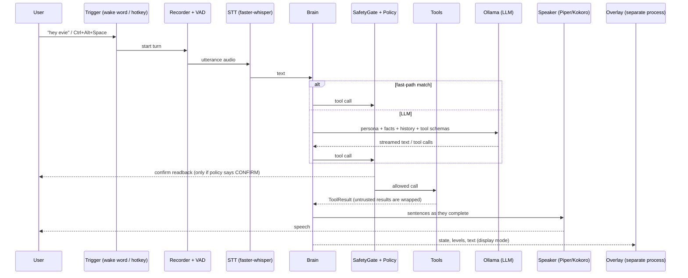
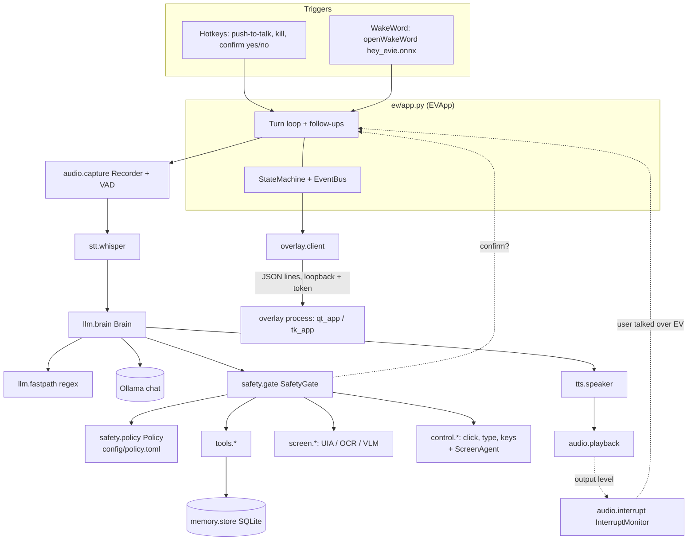
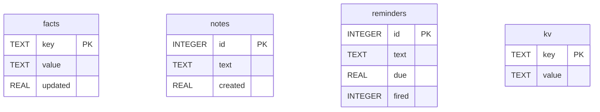
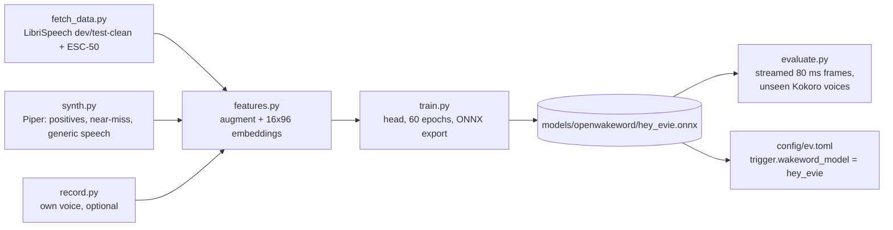

# EV: Project Documentation

> Generated 2026-10-30 from the code in this repository (working tree, including uncommitted changes). Statements are
> backed by files that were read; anything inferred or suggested is labelled as such.

## Project Overview

**EV** (package name `ev-assistant`, version `0.1.0`, `pyproject.toml`) is a fully local, voice-first desktop assistant for
Windows. You talk to it; it transcribes your speech on the CPU, asks a local LLM (through Ollama on `127.0.0.1`) what to
do, runs tools such as opening apps, setting timers or reading the screen, and speaks the answer back. The only
interface is a small overlay "pill" and a tray icon (`README.md`, `ev/app.py`).

| | |
|---|---|
| **Type** | Desktop voice assistant (Python application, Windows only) |
| **Language / runtime** | Python 3.11 or 3.12 (`requires-python = ">=3.11,<3.13"` in `pyproject.toml`; the conda env pins 3.12 in `environment.yml`) |
| **Size** | About 8,000 lines in `ev/` (counted with `wc -l` over `ev/*.py` and `ev/*/*.py`), 373 tests in 13 test files |
| **Maturity** | Early and actively changing. Version `0.1.0`; 3 commits in git history; `CHANGELOG.md` has everything under `[Unreleased]`; a large part of the work (display mode, web/close-app tools, wake-word training kit, barge-in rewrite) is still uncommitted (`git status`). |
| **Privacy stance** | No cloud, no telemetry. Egress is limited to optional DuckDuckGo search and Open-Meteo weather (`docs/SECURITY.md`, `config/ev.toml [web]`). |

### Contents

1. [Problem Statement](#problem-statement)
2. [Solution Overview](#solution-overview)
3. [How It Works](#how-it-works)
4. [Tech Stack](#tech-stack)
5. [Architecture](#architecture)
6. [Project Structure](#project-structure)
7. [Key Modules and Components](#key-modules-and-components)
8. [Data Model](#data-model)
9. [Tools and Interfaces](#tools-and-interfaces)
10. [Input and Output](#input-and-output)
11. [Wake-Word Model ("Hey Evie") and Its Training Outputs](#wake-word-model-hey-evie-and-its-training-outputs)
12. [Safety Model](#safety-model)
13. [Setup and Installation](#setup-and-installation)
14. [Configuration](#configuration)
15. [Testing and Quality](#testing-and-quality)
16. [Limitations and Known Issues](#limitations-and-known-issues)
17. [Future Improvements](#future-improvements)
18. [Dependencies and Third-party Services](#dependencies-and-third-party-services)
19. [Documentation Scope](#documentation-scope)

---

## Problem Statement

The repository never states the problem in one sentence. From `README.md` ("A fully local, voice-first assistant for
Windows. No cloud, no API keys, no telemetry.") and `docs/DECISIONS.md` the intent is clear:

* People want to control their PC and ask quick questions by voice, but mainstream assistants send audio and context to
  the cloud.
* Local LLMs are weak on tool use and unsafe if given control of a computer, so a local assistant has to be fast on
  modest hardware **and** safe against being talked into bad actions.

*Inferred:* the target user is the project owner, on a laptop with limited memory. `docs/DECISIONS.md` D2/D4 record a
machine with a Ryzen 5 7535HS, about 7 GB RAM, a 4 GB RTX 3050 Laptop GPU and Windows 10 Home, and the model
choices are driven by those limits.

## Solution Overview

EV splits the work so that each part fits the hardware and the risk is contained:

* **Speech to text on CPU** (faster-whisper, int8) keeps the 4 GB GPU free for the LLM.
* **A small local LLM** (`qwen2.5:3b`, fallback `llama3.2`) via Ollama chooses tools. A **regex fast path** answers
  common requests (time, timers, open app, volume, media, notes, weather, websites) without calling the LLM at all.
* **Tools** do the real work (apps, windows, browser, screen reading, mouse/keyboard, timers, notes, weather, search).
* **A safety gate outside the model** decides allow / confirm / block for every tool call from a TOML policy and the
  call's arguments only. Risky actions need a spoken "yes" that the system, not the model, collects.
* **Streaming speech output**: replies are split into sentences while the model is still generating, so speech starts
  early (Piper by default, Kokoro optional).
* **Overlay in a separate process** so a UI crash cannot take EV down.

## How It Works

One interaction, as implemented in `ev/app.py` (`on_trigger` → `_conversation` → `_one_turn`):

1. **Trigger.** A wake word ("hey evie" etc., `ev/audio/trigger.py::WakeWord`) or the push-to-talk hotkey
   (`Ctrl+Alt+Space`) fires `EVApp.on_trigger`. The wake listener releases the mic and stays paused for the whole turn.
2. **Listen.** `ev/audio/capture.py::Recorder` records with Silero VAD endpointing (`config/ev.toml [audio]`). The mic
   is open only while recording.
3. **Transcribe.** `ev/stt/whisper.py::STT` runs faster-whisper (`distil-small.en`, int8, CPU) after cleaning the audio
   (`clean_audio`: rumble filter and level normalisation) with hotwords biasing common vocabulary.
4. **Fast path or LLM.** `Brain.respond` first tries `llm/fastpath.py::match_fast`. A match runs the tool directly; a
   bare "thanks"/greeting/goodbye gets a canned reply (`match_smalltalk`). If neither applies, it builds a prompt (persona +
   remembered facts + rolling summary + today's date and part of the day + trimmed history; the prompt is kept stable so
   Ollama's prompt cache stays valid) and streams `/api/chat` from Ollama with the tool schemas.
5. **Tool calls.** Each call is schema-validated (`tools/base.py::validate_args`), checked by `SafetyGate`, then run in
   a thread pool with a per-tool timeout (a batch of side-effect-free tools runs concurrently; a slow tool gets a spoken
   "one sec" after `llm.filler_after_s`). Results from web/screen/file sources are wrapped as untrusted data
   (`safety/untrusted.py`) before the model sees them. The loop is capped at `max_tool_steps = 5`.
6. **Speak.** `SentenceSplitter` hands sentences to `tts/speaker.py::Speaker` as they complete; the reply is capped at 2
   sentences (6 when the user asks for detail). While EV speaks, `InterruptMonitor` listens for the user talking over it.
7. **Follow up.** After a reply EV keeps listening for 7 s (12 s if the reply was a question) without a wake word, plus
   2 s per back-to-back turn up to 15 s, up to 8 turns, unless the user wraps up ("thanks", "that's all"...).
8. **Display mode (optional).** If on, the overlay shows the user's text and EV's reply as a text card under the pill.



## Tech Stack

Versions are the constraints declared in `pyproject.toml` (not the installed versions, which were not inspected).

| Area | Technology | Role |
|---|---|---|
| Language | Python 3.11 / 3.12 | Whole application |
| LLM runtime | Ollama (HTTP on 127.0.0.1:11434), `httpx>=0.27` | Chat + tool calling; models `qwen2.5:3b`, fallback `llama3.2:latest`, vision `qwen2.5vl:3b` (`config/ev.toml [llm]`, `[vlm]`) |
| Speech to text | `faster-whisper>=1.1` | `distil-small.en`, int8, CPU, beam 3 |
| VAD | Silero (bundled with faster-whisper), energy fallback | End-of-speech detection (`ev/audio/vad.py`) |
| Text to speech | `piper-tts>=1.2` (default), optional `kokoro-onnx>=0.3` | Voice `en_US-hfc_female-medium` (Piper) |
| Wake word | optional `openwakeword>=0.6` | Custom model `hey_evie.onnx` |
| Audio I/O | `sounddevice>=0.5`, `numpy` | Mic capture, playback |
| Screen reading | `mss`, `pywinauto` (UIA), `rapidocr-onnxruntime`, VLM via Ollama | UIA, then OCR, then vision model, in that order |
| Control | `pyautogui`, `pynput`, `pycaw`, `comtypes`, `psutil` | Mouse/keyboard, global hotkeys, volume, processes |
| Overlay | `PySide6-Essentials>=6.7` (extra `overlay`), Tk fallback | Pill and text card |
| Tray | `pystray`, `pillow` | Tray icon |
| Web | `ddgs>=9.0`; Open-Meteo over `httpx` | Search and weather |
| Storage | SQLite (stdlib) | `data/ev.sqlite` |
| Quality | `pytest`, `pytest-timeout`, `ruff`, `mypy`, `bandit`, `pip-audit`, `detect-secrets`, `hypothesis`, `jiwer` | Extra `dev` |
| Wake-word training | PyTorch (separate venv or Colab/Kaggle), ONNX, `scikit-learn`, `scipy` | `scripts/wakeword/` (not part of the app's runtime) |
| Environment | conda env `ev` (`environment.yml`, Python 3.12, `pip install -e .[overlay]`) | The owner's setup |

## Architecture



Key points (all from the code):

* **State machine** (`ev/core/state.py`): `IDLE → LISTENING → TRANSCRIBING → THINKING → (ACTING) → SPEAKING → IDLE`,
  plus `ERROR` and `PAUSED`. Illegal transitions are refused and logged. Transitions publish `state` events; the overlay
  client and the wake-word pause/resume subscribe (`EVApp._on_state`).
* **Threading:** hotkey callbacks, the wake-word listener, the interrupt monitor, the scheduler and the confirmation
  listener each run on their own threads; a `_turn_lock` ensures one turn at a time (a second trigger during a turn
  cancels the recording).
* **Overlay IPC** (`ev/overlay/protocol.py`): newline-delimited JSON over a loopback TCP socket. The overlay is the
  server, binds `127.0.0.1` on an ephemeral port, receives a per-session token on stdin, and drops any client whose
  first line does not carry it (constant-time compare, 2 s deadline, 4096-byte line cap). Message types: `state`,
  `level`, `text`, `display`, `quit`.
* **Degradation** (`docs/ARCHITECTURE.md`, `ev/app.py`): Ollama down → spoken message; missing model → fallback model;
  no mic → spoken message; Kokoro fails to load → Piper; wake word fails → hotkey only; overlay failure is ignored.

## Project Structure

```
EV_AI/
├── ev/                         # the application package
│   ├── __main__.py             # python -m ev [--debug] [--repl]; forces offline/no-telemetry env vars
│   ├── app.py                  # EVApp: wiring, turn loop, confirmation, kill switch, tray
│   ├── repl.py                 # developer text REPL (no audio)
│   ├── core/                   # config.py (TOML + local override), events.py, state.py, log.py
│   ├── audio/                  # capture.py, vad.py, playback.py, trigger.py (hotkeys + wake word), interrupt.py
│   ├── stt/whisper.py          # faster-whisper wrapper, audio cleaning
│   ├── tts/                    # base.py, piper_engine.py, kokoro_engine.py, speaker.py
│   ├── llm/                    # brain.py, client.py (Ollama), fastpath.py, sentences.py, spoken.py
│   ├── tools/                  # base.py, builtin.py, system.py, windows.py, web.py, weather.py, scheduler.py
│   ├── screen/                 # capture.py, uia.py, ocr.py, vlm.py, tools.py
│   ├── control/                # tools.py (mouse/keyboard), agent.py (ScreenAgent)
│   ├── safety/                 # policy.py, gate.py, untrusted.py
│   ├── memory/store.py         # SQLite store
│   ├── overlay/                # client.py, protocol.py, display.py, anim.py, qt_app.py, tk_app.py, __main__.py
│   └── evals/                  # eval and benchmark suites, run via python -m ev.evals.run
├── config/                     # ev.toml, policy.toml, persona.md (+ git-ignored ev.local.toml)
├── docs/                       # ARCHITECTURE.md, DECISIONS.md (D1-D21), SECURITY.md, this file
├── scripts/
│   ├── download_models.py      # Piper voices, Whisper, openWakeWord base models (with SHA-256 records)
│   └── wakeword/               # wake-word training kit
│       ├── common.py synth.py fetch_data.py features.py train.py evaluate.py record.py
│       ├── train_cloud.ipynb   # the Colab/Kaggle notebook (source)
│       ├── README.md
│       └── trained_output/train_cloud_output.ipynb   # the executed notebook with training results
├── tests/                      # 12 test files, fakes.py (FakeOllama), conftest.py, data/ (recorded echo levels)
├── models/                     # git-ignored: piper/, kokoro/, openwakeword/ (incl. hey_evie.onnx)
├── data/                       # git-ignored: ev.sqlite, sandbox/, wakeword/ (training data, torch venv, kit zip)
├── logs/  evals/               # git-ignored runtime output
├── environment.yml  pyproject.toml  Makefile  start_ev.bat  start_ev_conda.bat  run_ev_debug_conda.bat
└── CHANGELOG.md  README.md  .claude/CLAUDE.md
```

## Key Modules and Components

| Module | Purpose | Notes |
|---|---|---|
| `ev/app.py` | `EVApp` composes everything and runs the turn loop. Owns confirmation (`confirm`), kill switch (`kill`, re-arms after 1 s), tray, display-mode tool and the `do_on_screen` tool. | Screen/control tools are registered lazily so a lightweight setup still starts. |
| `ev/llm/brain.py` | Prompt building, history trimming to the context budget, streaming tool loop, sentence cap, tool execution through the gate, rolling summary every 8 turns. | Primes Ollama's prompt cache (`warm`, `rewarm_if_cold`), runs the summary in the background and speaks a filler for slow tools. Drops sentences that name internal tools (e.g. "web_search"). Parses tool calls that a small model emits as JSON text. |
| `ev/llm/fastpath.py` | Regex intents: time, timers, reminders, display mode, screenshot, web search and weather (these two go back to the LLM to phrase), read screen, open app, site/search/open website, close app, volume, media, notes, forget, copy, paste. | Skips the LLM but still goes through the gate. See Limitations: the open-app pattern is greedy. |
| `ev/safety/policy.py` | Pure decision function: tool level, blocked patterns, app allowlist and name validation, website checks, close-app protection, key-combo and control rules, administrator wording. | Text is NFKC-normalised and invisible characters are stripped before matching. |
| `ev/safety/gate.py` | The only path to execution. BLOCK → deny; ALLOW → go; CONFIRM → system readback via `ask`, fails closed with no asker. Keeps a 200-entry audit list. | `YES`/`NO` regexes are strict ("yes but also…" is rejected). |
| `ev/safety/untrusted.py` | Wraps external text in a nonce-tagged block and flags instruction-like phrases from `[injection]` in `policy.toml`. | |
| `ev/audio/trigger.py` | `Hotkeys` (pynput global hotkeys) and `WakeWord` (openWakeWord, offline, 80 ms frames, 1 s cooldown). | `model_path()` accepts a model name or a `.onnx` path. |
| `ev/audio/interrupt.py` | `EchoDetector` + `InterruptMonitor` for barge-in on speakers: learns speaker-to-mic delay and echo gain, stays disarmed for the first 1.2 s of a reply. | Tuned from recorded levels (`tests/data/echo_laptop_speakers.json`, D20). |
| `ev/tools/` | The tool registry (`base.py`), built-in tools (`builtin.py`), app launching (`system.py`), window closing (`windows.py`), site URL building (`web.py`), weather, scheduler. | `web.build_url` is shared by the tool and the policy so both judge the same URL. |
| `ev/screen/` | Screen capture, UIA tree, OCR, VLM; `take_screenshot` saves a PNG (refuses sensitive windows). | VLM is unloaded right after use (`keep_alive = "0"`). |
| `ev/control/` | Click/type/keys/scroll/focus/copy/paste, each re-checking the resolved UI element against policy; `ScreenAgent` is a bounded observe→act→verify loop (8 steps, stuck detection). | |
| `ev/memory/store.py` | SQLite facts, notes, reminders, key-value. | No vector DB (D9). |
| `ev/overlay/` | Pill UI in its own process (Qt, Tk fallback); `display.py` is the toolkit-independent model of the text card. | UTF-8 wire format since display mode. |
| `ev/evals/` | Benchmarks and eval suites (security, intent, persona, memory, STT, TTS, VLM, soak, egress...). | Results go to `evals/results/`. |

## Data Model

SQLite database `data/ev.sqlite` (`ev/memory/store.py`):



The tables are independent (no foreign keys). `facts` holds things like the user's name or home city; `kv` holds the
rolling conversation `summary` and the `display_mode` flag (`ev/app.py`, `ev/llm/brain.py`). `[privacy]` in
`ev.toml` disables persisting audio and screenshots.

## Tools and Interfaces

EV has no network API. Its interfaces are voice, hotkeys, the tray menu and a few developer commands.

### Tools the model can call (25 registered)

| Group | Tools | Source |
|---|---|---|
| System | `get_time_date`, `open_app`, `close_app`, `open_website`, `set_timer`, `set_reminder`, `media_control`, `set_volume` | `ev/tools/builtin.py` |
| Information | `web_search`, `get_weather` | `ev/tools/builtin.py`, `weather.py` |
| Memory | `remember_fact`, `forget_fact`, `take_note` | `ev/tools/builtin.py` |
| Screen | `read_screen`, `screenshot_describe`, `take_screenshot` | `ev/screen/tools.py` |
| Control | `click_element`, `type_text`, `press_keys`, `scroll`, `focus_window`, `copy_selection`, `paste` | `ev/control/tools.py` |
| Agent / UI | `do_on_screen` (multi-step screen task), `set_display_mode` | `ev/app.py` |

`policy.toml` also lists `run_shell` (blocked), `delete_file`, `move_file` and `send_message` (confirm), but I found no
registration of those tools in `builtin.py`, `control/tools.py` or `screen/tools.py`, so they currently have a policy
level but no implementation.

### Hotkeys (`config/ev.toml [hotkeys]`)

| Action | Default |
|---|---|
| Push-to-talk (also interrupts speech) | `Ctrl+Alt+Space` |
| Kill switch | `Ctrl+Alt+Shift+K` |
| Confirm yes / no | `Ctrl+Alt+Y` / `Ctrl+Alt+N` |

### Commands

```powershell
python -m ev --debug                     # run the assistant with console logs
python -m ev --repl --debug              # developer text REPL (no audio)
python -m ev.overlay --demo [--display]  # preview the pill (and text card)
python -m ev.evals.run <suite>           # security | security-nollm | intent | persona | memory | all
python scripts/download_models.py --voice <name> --whisper <sizes> --wakeword <names>
```

## Input and Output

| Direction | What | Format |
|---|---|---|
| In | Microphone | 16 kHz mono blocks of 30 ms (`[audio]`); utterances up to 15 s |
| In | Keyboard hotkeys | pynput global hotkeys |
| In | Screen | Screenshots (in memory), UIA tree, OCR text |
| In | Web | DuckDuckGo results, Open-Meteo forecast |
| Out | Speech | Sentences synthesised by Piper/Kokoro and played through `sounddevice` |
| Out | Overlay | Pill state, audio level, optional text card |
| Out | Files | `Pictures\EV Screenshots\EV <date time>.png` (screenshots on request), `logs/ev.log` (redacted), `data/ev.sqlite`, notes under `data/notes` |

Overlay wire messages (`ev/overlay/protocol.py::valid_message`):

```json
{"t":"state","v":"listening"}
{"t":"level","v":0.42}
{"t":"text","who":"user","v":"open Spotify","append":false}
{"t":"display","v":true}
{"t":"quit"}
```

Example fast-path outcomes taken from the matchers in `ev/llm/fastpath.py`: "set a timer for ten minutes" →
`set_timer`; "open Firefox, open YouTube and search for ..." → one `open_website` call; "activate display mode" →
`set_display_mode(enabled=true)`.

---

## Wake-Word Model ("Hey Evie") and Its Training Outputs

This section covers `scripts/wakeword/` and the new `trained_output` folder.

### What was built

One small openWakeWord classifier head, `hey_evie.onnx`, meant to answer to **"hey evie", "hey EV", "evie" and "EV"**
(`scripts/wakeword/README.md`, `common.py::POSITIVE_PHRASES`). openWakeWord's shared melspectrogram and embedding models
turn 2 s of audio into one 16×96 window; only the classifier head on top is trained. EV's runtime `WakeWord` class loads
any custom `.onnx` through `trigger.wakeword_model`, so no application code had to change.

### Pipeline



| Script | What it does |
|---|---|
| `common.py` | Paths, phrase lists. Positives are weighted (bare "evie" ×4, "hey evie" ×5, "E V" ×3...). Near-miss list covers "every", "Eddie", "TV", "hey Siri", "Genevieve" and many more; `COMMANDS` holds things people say to EV. |
| `fetch_data.py` | Downloads LibriSpeech dev-clean (train negatives), test-clean (held out for false-trigger measurement) and ESC-50 noise into `data/wakeword/raw`. Training-time only. |
| `synth.py` | Piper synthesis from six voices (EV's `hfc_female` has the biggest share, plus amy, lessac, ryan, alan, libritts_r). Positives, near-misses and generic speech use the same voice mix so "synthetic voice" is not the giveaway. |
| `features.py` | Noise/reverb/EQ/pitch/speed augmentation, then embeddings. `--reps` copies per clip (default 3). Mixes in your own recordings when present. |
| `train.py` | Head: Flatten → Linear(1536→64) → ReLU → LayerNorm → Linear(64→64) → LayerNorm → ReLU → Linear(64→1) → Sigmoid. AdamW + OneCycle, negative weight ramped 1→4, averages late checkpoints, exports ONNX (opset 13). |
| `evaluate.py` | Streams audio through `openwakeword.Model` in 80 ms frames. Prints recall on held-out Kokoro voices, near-miss triggers and false triggers per hour at thresholds 0.3 to 0.9. |
| `record.py` | Records your own voice (positives and 90 s of ordinary talk) for training and held-out evaluation. |
| `train_cloud.ipynb` | Runs the whole chain on Colab or Kaggle CPU in roughly 1 to 2 hours. |

### What the trained output shows

`scripts/wakeword/trained_output/train_cloud_output.ipynb` is the executed Colab run (working dir `/content/ev`, 2 CPUs,
torch `2.11.0+cpu`). Values below are copied from its saved cell outputs.

**Data**

| Item | Value |
|---|---|
| Synthesised Piper clips | 20,000 (`--pos 8000 --adv 6000 --gen 6000`) |
| Training set | 28,188 base clips → 64,188 windows (16×96), **21,600 positive** |
| Validation set | 2,569 base clips → 2,569 windows, 800 positive |
| Model | 102,849 parameters, 60 epochs |
| Checkpoint | "using averaged late checkpoints" |
| Output | `hey_evie.onnx`, 405 KB |

**Validation at threshold 0.5 (window level, from `train.py`)**

| Metric | Value |
|---|---|
| Recall (positives) | 0.940 |
| False-positive rate (all negatives) | 0.0220 |
| Near-miss words (`adv`) | 0.0517 |
| Generic speech (`gen`) | 0.0067 |
| Noise | 0.0067 |
| Real speech (`real`) | 0.0074 |

**Recall on held-out Kokoro voices (from `evaluate.py`, a different TTS engine than training)**

| Phrase | 0.3 | 0.5 | 0.7 | 0.9 |
|---|---|---|---|---|
| hey evie | 0.98 | 0.98 | 0.95 | 0.95 |
| hey EV (`hey E V`) | 1.00 | 1.00 | 1.00 | 1.00 |
| evie | 0.93 | 0.90 | 0.88 | 0.86 |
| eevee | 0.88 | 0.86 | 0.86 | 0.81 |
| E V | 1.00 | 1.00 | 1.00 | 1.00 |
| **ALL phrases** | **0.98** | **0.97** | **0.97** | **0.96** |

The weakest phrases are bare "eevee" (0.86 at 0.5) and "evie" (0.90 at 0.5).

### Where it is deployed

* `models/openwakeword/hey_evie.onnx` exists locally (414,663 bytes), next to `embedding_model.onnx`,
  `melspectrogram.onnx` and the placeholder `hey_jarvis_v0.1.onnx`.
* `config/ev.toml` already has `trigger.mode = "wakeword"`, `wakeword_model = "hey_evie"`, `wakeword_threshold = 0.5`.
* *Observed during this session (a debug console log the user shared, not something stored in the repo):* the wake word
  fired with a score of 0.53 ("wake word heard").

### Gaps in the saved training output

* The saved `evaluate.py` output stops after the recall table. The script also prints near-miss trigger rates, a
  "your own voice" row and **false triggers per hour** on 2 h of LibriSpeech test-clean plus ESC-50 noise, but none of
  that appears in the notebook output, so the real-world false-trigger rate at threshold 0.5 is **not documented**. The
  `real` and `noise` figures above are per-window validation rates, not per-hour rates.
* Recall is measured on synthetic Kokoro voices only. No recordings of the owner's voice were in the kit (the notebook
  mentions `data/wakeword/recordings/` as optional), so recall on a real mic and voice is *Not determinable from the
  codebase*.
* `data/wakeword/` contains `features`, `raw`, `synth`, `venv` and `ev_wakeword_kit.zip`, but no `recordings/` folder.

---

## Safety Model

This is the project's central design rule (`.claude/CLAUDE.md`, `docs/SECURITY.md`): **the model proposes, policy
disposes.**

* Every tool call from the LLM, the fast path or the screen agent passes through `SafetyGate` → `Policy.evaluate`.
  Decisions depend only on `config/policy.toml` and the arguments.
* `unknown_tool = "blocked"`, so a new tool must be given a level in `[tools]` or it cannot run.
* **Confirm** actions are read back by the system and need a real spoken yes (strict regex) or `Ctrl+Alt+Y`. With no
  asker the gate fails closed; a kill event denies everything.
* **Block** examples: password fields and sensitive windows, `Win+R`, `Alt+F4`, registry/credential patterns,
  `..\` paths, non-public web addresses, protected processes (Windows services, Defender, Ollama).
* **Confirm** examples: clicking controls named send/submit/delete/buy/pay/install, pressing Enter/Delete/Ctrl+W,
  force-closing an app, any administrator wording, unfamiliar websites.
* Results from web, screen and files set `ToolResult.untrusted=True` and are wrapped as data.
* Overlay IPC is loopback with a per-session token; Ollama client refuses non-loopback hosts (`docs/SECURITY.md`).

`ev/evals/security.py` and `ev/evals/datasets.py` hold the red-team suite (blocked actions, bypass attempts, injections,
runaway agent loop, egress check).

## Setup and Installation

The owner uses **conda only** (env `ev` already created). Sources: `environment.yml`, `start_ev_conda.bat`,
`run_ev_debug_conda.bat`, `pyproject.toml`, `README.md`.

```powershell
# 1. Environment (already done on the owner's machine)
conda env create -f environment.yml          # python 3.12 + pip install -e .[overlay]
conda activate ev
pip install openwakeword                     # for wake-word mode (extra "wakeword"; not in environment.yml)
pip install -e ".[dev]"                      # tests, ruff, mypy (optional)

# 2. Local models (all downloaded once; EV is offline at runtime)
ollama pull qwen2.5:3b
ollama pull llama3.2
ollama pull qwen2.5vl:3b
python scripts\download_models.py --voice en_US-hfc_female-medium --whisper distil-small.en --wakeword hey_jarvis
# hey_evie.onnx is the trained model: place it in models\openwakeword\

# 3. Run
run_ev_debug_conda.bat                       # foreground, logs in the console
start_ev_conda.bat                           # background, no console window
python -m ev --debug                         # equivalent, inside the activated env
```

Ollama must be running (`ollama serve` or the tray app). Autostart is opt-in via `schtasks` (`README.md`).

`download_models.py` offers Piper voices (`VOICES`) and openWakeWord base models (`OWW_MODELS`: alexa, hey_mycroft,
hey_jarvis, hey_rhasspy, timer, weather); the `hey_jarvis` download also supplies the shared melspectrogram and embedding
models that `hey_evie` needs. STT loads with `local_files_only=True` (`ev/stt/whisper.py`), so the Whisper model must be
downloaded beforehand. Whether `--whisper distil-small.en` is an accepted name was not verified (`README.md` shows
`base`; `config/ev.toml` now uses `distil-small.en`).

Training the wake word again: see `scripts/wakeword/README.md` (Colab/Kaggle notebook, or locally with a separate torch
venv at `data/wakeword/venv`). Note that README's command examples use `.venv\Scripts\python`; with conda, substitute
the `ev` environment's Python.

## Configuration

| File | Purpose |
|---|---|
| `config/ev.toml` | Every tunable. Sections: `general`, `hotkeys`, `trigger`, `conversation`, `audio`, `stt`, `tts`, `llm`, `vlm`, `screen`, `overlay`, `memory`, `privacy`, `web`, `tray`. |
| `config/ev.local.toml` | Git-ignored, deep-merged over `ev.toml` per machine (`ev/core/config.py`). |
| `config/policy.toml` | Tool levels, app allowlist and protected apps, trusted web hosts, safe folders, control rules, confirm/blocked/injection patterns. |
| `config/persona.md` | System persona, read at startup; re-run `python -m ev.evals.run persona` after editing. |

Notable current values (`config/ev.toml`): `trigger.mode = "wakeword"`, `stt.model = "distil-small.en"`,
`tts.engine = "piper"` (`en_US-hfc_female-medium`), `llm.model = "qwen2.5:3b"`, `llm.num_ctx = 4096`,
`llm.reply_max_sentences = 2`, `conversation.interrupt_margin = 1.5`, `overlay.display_mode = false`,
`llm.direct_tool_replies = false`, `llm.filler_after_s = 1.3`, `conversation.followup_patience_s = 2`, `conversation.continuous_mic = false`.

**Environment variables.** The code reads none for configuration. `ev/__main__.py` *sets* `HF_HUB_OFFLINE`,
`HF_HUB_DISABLE_TELEMETRY`, `DO_NOT_TRACK`, `ANONYMIZED_TELEMETRY` and `TRANSFORMERS_OFFLINE` at startup. No secrets or
API keys are used anywhere in the project.

## Testing and Quality

* **Framework:** pytest (`tests/`, 373 tests across 13 files). Markers: `integration`
  (pipeline with mocked hardware), `eval`, `hardware`; by default `eval` and `hardware` are excluded (`pyproject.toml`).
* **Fixtures:** `tests/conftest.py` (`cfg`, `policy`, `memory`, `scheduler`, `gate`, `registry` with a fixed clock) and
  `tests/fakes.py::FakeOllama`, an httpx transport replaying scripted replies.
* **Recorded data:** `tests/data/echo_laptop_speakers.json` holds recorded audio *levels* only, used by the barge-in tests.
* **Commands:** `make check` (ruff + mypy + pytest), `make unit`, `make integration`, `make security`, `make eval`. The
  Makefile hard-codes `.venv/Scripts/python.exe`, so under conda run the underlying commands directly:
  `python -m ruff check ev tests`, `python -m mypy ev`, `python -m pytest -q`.
* **Lint / types:** ruff (line length 120, rules `E,F,I,B,S,UP`), mypy (`check_untyped_defs`), bandit and pip-audit in
  the `dev` extra.
* **CI:** none found (no `.github/workflows` or other CI config).
* **Test run status:** 373 passed (unit + integration), ruff and mypy clean, security suite 88/88 with 0 bypasses (run on 2026-10-30, after the D21 latency changes).

## Limitations and Known Issues

Observed in the code, docs and the user's console log:

1. **Fast-path "open" is greedy** (`ev/llm/fastpath.py:204`). Any "open …" phrase that does not match the
   `_CHATTY_OPEN` exclusions becomes an `open_app` call, e.g. "Open the particular screenshot you just took" was heard as
   an app named "particular screenshot you just took" and answered "I couldn't find an app called…" without ever
   reaching the LLM.
2. **No file-opening tool and no "last created file" memory.** `take_screenshot` returns the saved path in `data`
   (`ev/screen/tools.py:55`) but nothing opens it later, and replies like "Here's the screenshot" do not show it.
3. **EV is reactive, not autonomous.** The LLM loop is capped at 5 tool calls per turn (`max_tool_steps`); only
   `do_on_screen` runs a multi-step loop (8 steps). No background goals, no planning loop.
4. **Small-model weaknesses.** A 3B model can invent answers (for example it explained its "context window" incorrectly in
   the shared log). Mitigations in code: reply caps, tool-name filtering, persona rules, hints on tool results.
5. **Documentation drift** (checked 2026-10-31): README, the `config/ev.toml` wake-word comment, DECISIONS D8,
   ARCHITECTURE (VLM name) and SECURITY (lockfile wording) were brought in line with the code. What remains:
   the Makefile and `CLAUDE.md` still assume `.venv`, and `docs/DECISIONS.md` D4 is a historical record that names
   `moondream` as it was at the time.
6. **Redundant files for a conda-only setup:** `.venv/`, `start_ev.bat`, and the Makefile's `.venv` path.
7. **Policy entries without tools:** `delete_file`, `move_file`, `send_message`, `run_shell` have levels in
   `policy.toml` but no registered implementation (see Tools).
8. **Wake word not measured end to end:** false triggers per hour are missing from the saved output (see wake-word
   section); recall is on synthetic voices only.
9. **Windows-only and hardware-specific.** UIA, `pycaw`, `WM_CLOSE` window handling and global hotkeys are Windows APIs.
   Barge-in tuning was measured on one laptop (D20).
10. **Display mode shows the transcript on screen**, so EV's own screen reading and screenshots can capture it; hiding
    the card from capture was tried and removed (D19).
11. **Network dependence of web features.** DuckDuckGo sometimes returns a bot check; EV retries and reports honestly
    (`CHANGELOG.md`).
12. **Housekeeping:** `TODO`/`FIXME` markers: none found in code (the only matches are test data strings).

## Future Improvements

*Suggestions, tied to the gaps above (not planned work in the repo):*

* Tighten the fast-path open-app pattern (reject phrases containing "screenshot", "file", "you just", "that", and send
  them to the LLM), with tests.
* Add `open_file` and a "last created file" value so follow-ups like "open it" work.
* Add a bounded planner loop for multi-step requests, keeping every step behind `SafetyGate`; test whether the 3B model
  is enough or whether a larger local model should be used only for planning.
* Re-run `evaluate.py` and keep its full output (especially false triggers per hour); record some of your own voice with
  `record.py` and retrain to check real-mic recall; choose `wakeword_threshold` from that table.
* Move the Makefile and README to the conda workflow and remove `.venv` leftovers.
* Update README, DECISIONS (add a wake-word decision) and ARCHITECTURE to match the current setup.
* Add CI that runs ruff, mypy and the non-hardware tests.
* Optional: a notes layer backed by an Obsidian vault with FTS5 search, as discussed earlier, kept read-only at first and
  treated as untrusted input.

## Dependencies and Third-party Services

| Service / dependency | Used for | Data leaves the machine? |
|---|---|---|
| Ollama (local) | LLM and VLM inference | No (127.0.0.1 only) |
| DuckDuckGo via `ddgs` | `web_search` (optional, `[web] enabled`) | Yes: the query text |
| Open-Meteo | `get_weather` (optional, `weather_enabled`) | Yes: the city name and coordinates |
| Hugging Face (rhasspy/piper-voices, Systran Whisper) | One-time model downloads by `scripts/download_models.py` | Download only; EV sets offline env vars at runtime |
| openWakeWord GitHub release | Base wake-word models | Download only |
| Colab / Kaggle (training only) | Running `train_cloud.ipynb` | Training kit and public datasets, no user audio unless `recordings/` is zipped in |
| LibriSpeech, ESC-50 | Negative speech and noise for wake-word training | Download only |
| Piper voice licence | `en_US-hfc_female-medium` data is CC BY-NC-SA 4.0 (non-commercial) per `CHANGELOG.md` | n/a |

## Documentation Scope

* **Analysed:** `ev/` (all modules skimmed; `app.py`, `brain.py`, `policy.py`, `gate.py`, `trigger.py`, `interrupt.py`,
  `protocol.py`, `state.py`, parts of `builtin.py`, `web.py`, `fastpath.py` read in full or in large part), `config/`,
  `docs/`, `scripts/` (including the whole `wakeword/` kit and `trained_output/train_cloud_output.ipynb`), `tests/`
  (structure and counts), `pyproject.toml`, `environment.yml`, `Makefile`, `README.md`, `CHANGELOG.md`.
* **Not analysed in depth:** `ev/overlay/qt_app.py` and `tk_app.py` internals, `ev/evals/*` suites beyond their
  docstrings, `ev/screen/*` and `ev/control/*` implementation details, `ev/tts/*` engines, `ev/stt/whisper.py`
  internals, individual test bodies.
* **Skipped:** `.git`, `.venv`, `data/wakeword/venv`, model weights, `__pycache__`, git-ignored data and logs.
* **Not run:** tests, linters, the app, and any training or evaluation script. Test counts come from parsing test
  function names.
* **Generated:** 2026-10-30.
